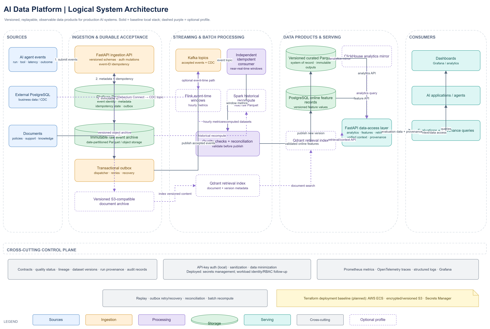

# AI Data Platform

An event data platform for AI-agent operations: validate execution events,
retain raw evidence, stream operational metrics, rebuild curated datasets, and
reconcile streaming results with batch outputs.

The project is a local development and portfolio project, not a production
deployment. The default stack is the recommended starting point; CDC, document
retrieval, Flink, Spark, ClickHouse, and Qdrant are optional local layers.



The image is a target/logical view: dashed components are optional profiles,
and its presence does not mean each path has passed integration testing. See
[the current capability status](docs/ARCHITECTURE_EXPANSION.md) for evidence.

## Five-minute quickstart

Requirements: Docker with the Compose plugin.

```powershell
docker compose up --build -d
docker compose ps
```

Wait for the `api` service to become healthy, then open:

- API and interactive endpoint docs: <http://localhost:8000/docs>
- Platform navigation: <http://localhost:8000/dashboard>
- Grafana operations dashboard: <http://localhost:3000> (`admin` / `admin`, local development only)
- Prometheus: <http://localhost:9090>

The local Compose API key defaults to `local-development-key`. Mutation
requests in the demo send it in `X-API-Key`; change it before using the stack
in any shared environment. Do not expose this Compose setup to the internet.

Run the documented synthetic workflow in
[docs/DEMO.md](docs/DEMO.md). To stop the stack while preserving local volumes:

```powershell
docker compose down
```

## What the default stack does

1. `POST /v1/events` validates a versioned event and records event metadata,
   raw Parquet, and an outbox entry.
2. The dispatcher publishes outbox entries to Kafka; the consumer updates
   streaming metrics.
3. `POST /v1/datasets/agent-metrics` builds a quality-gated, versioned metrics
   dataset in Parquet.
4. `/v1/streaming/metrics` and `POST /v1/reconciliation` expose streaming
   results and differences for investigation.
5. Replay and evaluation/provenance APIs provide additional workflows; see the
   [API docs](http://localhost:8000/docs).

The existing Grafana dashboard already covers accepted/rejected events,
consumer lag, processing failures, dataset quality, and freshness. A separate
custom dashboard is not needed to demonstrate the current core workflow.

## Tests and evidence

Run the current test suite from the repository root:

```powershell
python -m pytest -q
```

At present, the test directory contains schema/contract tests; this command
does **not** validate the complete multi-service workflow. CI runs the same
pytest command. See [docs/KNOWN_LIMITATIONS.md](docs/KNOWN_LIMITATIONS.md) for
the current evidence gaps and
[docs/MANUAL_TEST_RESULTS.md](docs/MANUAL_TEST_RESULTS.md) for dated local
checks, including a failed document-ingestion request.

No benchmark results are published yet. The current benchmark script also
needs an API-key option before it can measure the default authenticated Compose
API; see [docs/BENCHMARK_RESULTS.md](docs/BENCHMARK_RESULTS.md). Do not use
unmeasured numbers on a resume.

## Architecture and project docs

- [Capability status and architecture](docs/ARCHITECTURE_EXPANSION.md)
- [Synthetic end-to-end demo](docs/DEMO.md)
- [Known limitations and evidence gaps](docs/KNOWN_LIMITATIONS.md)
- [Benchmark method and results record](docs/BENCHMARK_RESULTS.md)
- [Architecture decision records](docs/adr/README.md)
- [Operations and recovery](docs/PHASE_2_OPERATIONS.md)
- [Security and governance](docs/PHASE_3_GOVERNANCE.md)
- [Optional services runbook](docs/ADVANCED_LAYER_RUNBOOK.md)
- [Resume-ready project guide](docs/RESUME_PROJECT_GUIDE.md)

## Optional profiles and cloud

The `sources` profile starts LocalStack S3 and a sample CDC source. The
`advanced` profile starts ClickHouse, Qdrant, Flink, and Spark. These are local
experiments, not required for the default demo. In particular, document
ingestion returned HTTP 500 in the recorded manual test and must be fixed and
covered before archive-to-retrieval is presented as working.

Terraform is a partial AWS baseline only. No deployed cloud environment or
cloud acceptance test is recorded. Review
[docs/REMAINING_WORK_GUIDE.md](docs/REMAINING_WORK_GUIDE.md) before making any
deployment claim.
